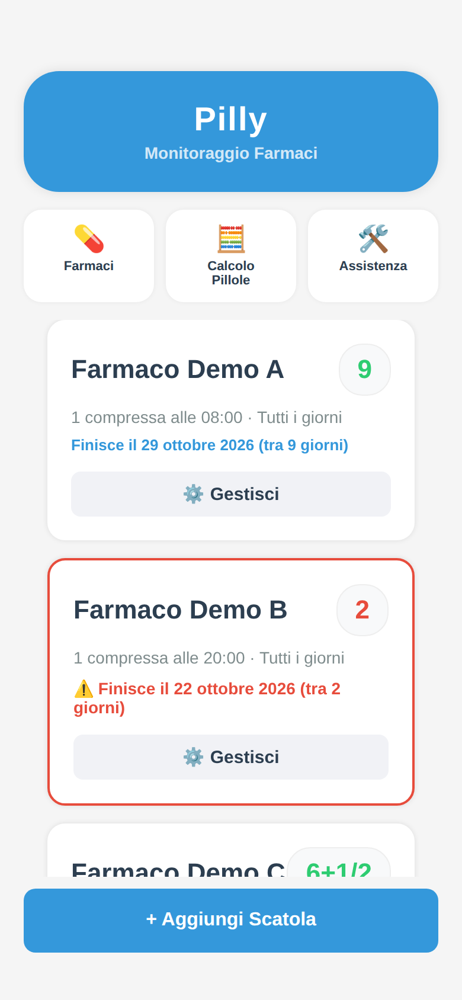
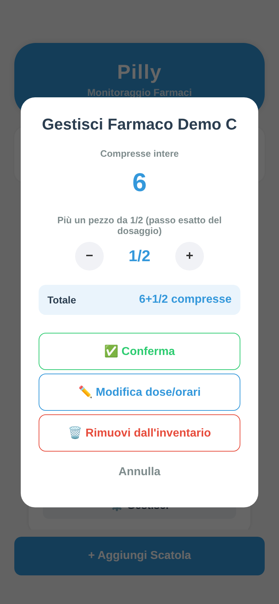
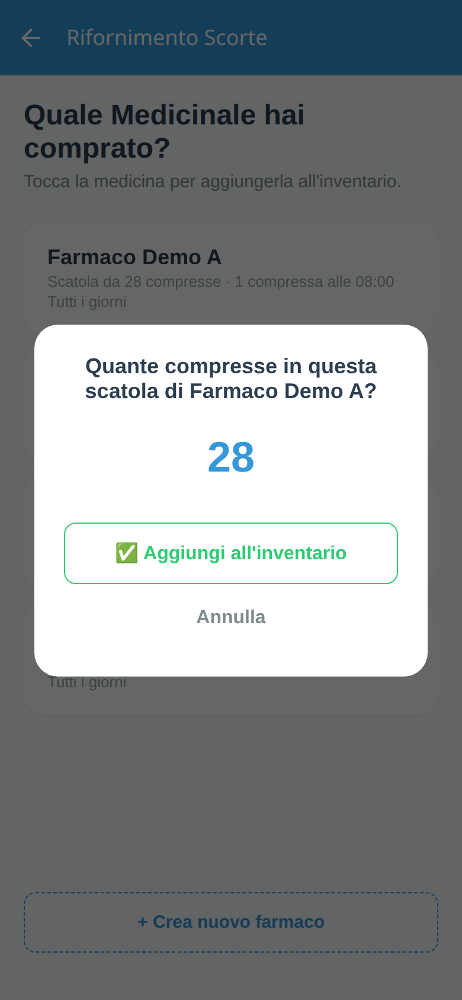
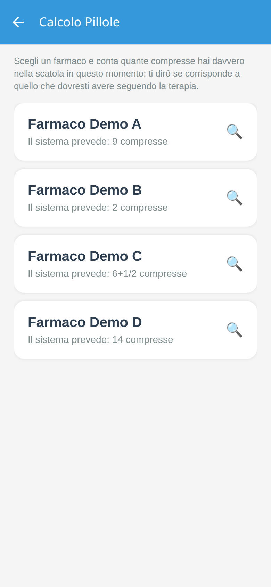
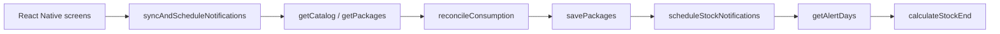

# Pilly

**An offline-first medication inventory that tells you when the next box will run out.**

Pilly tracks how many pills are left, simulates the therapy schedule forward, and schedules local reminders for the last five days before a box is empty. No account, no cloud, no spreadsheet.

[](https://github.com/LaroccaA/Pilly/actions/workflows/ci.yml)
[](LICENSE)
[](https://expo.dev)
[](https://reactnative.dev)

## Screenshots

These captures come from the web build at 390 × 844 with generic demo data. The same React Native screens run on Android and iOS.

| Inventory | Correct the stock |
| --- | --- |
|  |  |

| Add a box | Count the pills |
| --- | --- |
|  |  |

## Why Pilly

Most medication trackers assume you want an account, a cloud sync service, and a notification for every pill. Pilly starts from a smaller problem: *how many pills are actually left in the house, and when should I buy the next box?*

The app is deliberately local-first:

- the inventory lives on the device;
- the stock-end prediction is deterministic arithmetic, not a server job;
- notifications are scheduled locally and remain valid while the app is closed;
- the UI is small enough to use with one hand.

The interface is in Italian, because that is the language of the people who use it. Code, comments, and documentation are in English.

## What it does

- **Medication catalog** — create a card with a name, default box size, one or more daily intake times, fractional doses (1/4, 1/3, 1/2, 1), and weekdays.
- **Inventory** — add a box, see the remaining amount as a mixed fraction (`6+1/2`), and edit the stock manually.
- **Stock-end prediction** — calculates the exact date and time of the last possible dose from the current stock and the schedule.
- **Local reminders** — schedules one notification on each of the last five calendar days with an intake before the stock ends. The “in 3 days” text is computed when the notification is scheduled, so it stays correct even if the app is never reopened.
- **Manual verification** — count the pills in the box and compare the result with the expected stock. If the count differs, Pilly explains the gap in doses and can adopt the counted value.
- **Offline by default** — no account, no backend, no network dependency at runtime.

## How the consumption engine works

The domain logic lives in `lib/consumption.ts` and is the part worth reviewing.

### 1. The checkpoint is the source of truth

Each inventory package stores `remaining` and `lastUpdatedAt`. `lastUpdatedAt` is a checkpoint: “the remaining amount was correct at this instant”.

When the app opens, `reconcileConsumption` walks from the checkpoint to *now*, minute by minute across the configured intake times. For every scheduled dose that falls inside the interval, it subtracts the dose. The checkpoint then moves to now.

This makes the result independent of how often the app is opened. Opening it once a day and opening it once a month produce the same remaining quantity.

### 2. The stock-end prediction

`calculateStockEnd` takes the reconciled remaining quantity and simulates the schedule forward:

- it sorts the intake slots by time;
- it walks day by day, respecting weekdays;
- it subtracts each future dose until the remaining quantity is exhausted;
- it returns the exact `Date` of that last dose and the number of calendar days from today.

The prediction is pure arithmetic. It can be computed once and remains correct while the app is closed.

### 3. The notification window

`getAlertDays` returns the last five calendar days that have at least one scheduled intake before the stock ends. For each day it picks the first intake time and returns that as the notification date.

`syncAndScheduleNotifications` is the only place in the app that writes the reconciled state and reschedules notifications. Every mutation (new box, edited therapy, manual correction, deletion) goes through it. That single pipeline is the main state-integrity invariant: what the user sees and what the notification system uses cannot drift apart.

### 4. Fractional quantities

Doses are fractions of a pill. The app never displays a decimal quantity:

- `doseDenominator` converts a dose to its step denominator (1/3 → 3);
- `medicationDenominator` takes the finest denominator across all slots;
- `splitIntoFractions` and `formatMixedNumber` render quantities like `14+1/3`.

This is also why the steppers move by the exact dose step instead of a whole pill.

## Architecture

Pilly is a small Expo Router app with a deliberately isolated domain layer.

```text
app/
  _layout.tsx            Stack routes and navigation theme
  index.tsx              Inventory, stock management, support panel
  medications.tsx        Medication catalog
  medication-form.tsx    Create/edit a therapy card
  add-package.tsx        Add a box to the inventory
  pill-count.tsx         Manual stock reconciliation
lib/
  storage.ts             AsyncStorage persistence and demo seed
  consumption.ts         Reconciliation, stock-end prediction, alert days
  notifications.ts       Local notification scheduling
  sync.ts                Single save-and-reschedule pipeline
types/
  medication.ts          Domain types and quantity formatting helpers
docs/
  screenshots/           README captures
.github/
  workflows/ci.yml       Lint, typecheck, Android JS bundle
  dependabot.yml         Dependency updates
```

### Runtime flow



### Delivery and infrastructure

- **Offline-first architecture** — there is no server to operate. AsyncStorage is the only persistence layer.
- **Deterministic state transitions** — reconciliation and prediction are pure functions over the stored checkpoint and schedule.
- **Reproducible setup** — `.nvmrc`, `package-lock.json`, and `npm ci`.
- **CI** — GitHub Actions runs lint, TypeScript, and an Android JavaScript bundle on every push and pull request.
- **Native delivery** — EAS Build profiles in `eas.json` produce an installable Android APK with `preview` and an incrementing production build with `production`.
- **Dependency upkeep** — Dependabot keeps GitHub Actions current; Expo SDK packages are aligned with `npx expo install --fix`.

There is intentionally no backend, database, authentication service, or cloud sync. “Cloud” here is limited to the build pipeline; the product itself is device-local.

## Tech stack

| Layer | Choice |
| --- | --- |
| Runtime | Expo SDK 54, React Native 0.81, React 19 |
| Navigation | Expo Router 6 |
| Language | TypeScript 5.9 |
| Persistence | `@react-native-async-storage/async-storage` |
| Notifications | `expo-notifications` |
| Tooling | ESLint, `expo-doctor`, EAS CLI, GitHub Actions |

## Requirements

- Node.js **20.19.4 or newer** (the repo pins it in `.nvmrc`)
- npm
- Expo Go on a physical device, or an Android/iOS emulator
- For a standalone APK: an Expo account and EAS CLI

## Getting started

```bash
git clone https://github.com/LaroccaA/Pilly.git
cd Pilly
nvm use
npm ci
npm start
```

Then choose a target:

```bash
npm run android
npm run ios
npm run web
```

`npm run web` is useful for layout work. Local notifications are only available in the native apps.

## Quality checks

```bash
npm run lint
npm run typecheck
npm run export          # Android JavaScript bundle, no native toolchain required
npx expo-doctor
```

## Build an APK

The repository does not contain an APK or signing credentials. Create your own EAS project, then build:

```bash
npx eas-cli login
npx eas-cli init
npx eas-cli build -p android --profile preview
```

`preview` produces an internal APK; `production` produces an app bundle and increments the version.

## Data and privacy

- The app ships with generic demo data (`Farmaco Demo A` … `Farmaco Demo F`). No real medication names or personal health data are included.
- All runtime data stays on the device in AsyncStorage. Pilly has no backend, analytics, telemetry, or account system.
- The storage keys `catalogo_farmaci` and `pacchi_pillole` are intentionally kept in Italian for compatibility with existing local installs.
- Nothing is sent anywhere by the app. Network access is only needed for installing dependencies and building with EAS.

## What this app does not do

- It is **not a medical device** and does not provide medical advice.
- It does not know whether a dose was actually taken. It infers consumption from the schedule and the checkpoint.
- It does not include a drug database, interactions, prescriptions, or dosage recommendations.
- It does not sync between devices and has no account or cloud backup.
- It does not manage multiple active boxes of the same medication; one active package per medication is the model.
- It does not guarantee notification delivery. Android and iOS can delay or suppress local notifications because of battery settings, focus modes, or OS policy.
- It does not support web notifications; the web target is for development and layout preview.
- It does not have an automated test suite yet. CI covers lint, typecheck, and bundling.

## Transparency

Developed locally in 2026, published on GitHub in 2026. The project is a portfolio piece and a real personal utility, not a commercial medical product.

## License

[MIT](LICENSE) © 2026 Andrea La Rocca

## Acknowledgements

Built with [Expo](https://expo.dev), [React Native](https://reactnative.dev), [Expo Router](https://docs.expo.dev/router/introduction/), [AsyncStorage](https://react-native-async-storage.github.io/async-storage/), and [expo-notifications](https://docs.expo.dev/versions/latest/sdk/notifications/).
